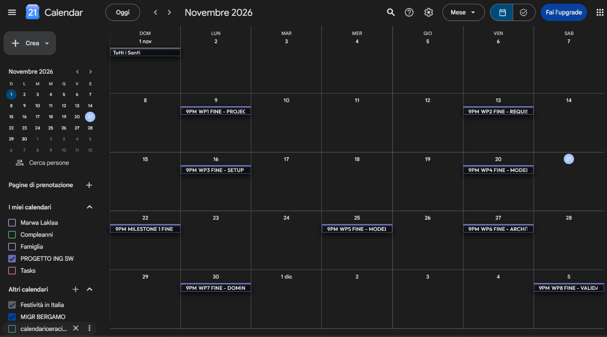

# Software Life Cycle

### Modello di Processo Adottato

Per lo sviluppo del progetto *Smart Rescue System*, il team ha adottato un **processo di sviluppo iterativo e incrementale** basato su **timeboxing** (scandito dalle milestone ufficiali del corso) e integrato con pratiche agili derivate da **Extreme Programming (XP)** (sviluppo incrementale, *Pair Programming*, *Collective Code Ownership* e testing continuo con JUnit 5).

Questa scelta consente di:
* Consegnare incrementi funzionanti e verificabili a ogni scadenza, riducendo il rischio di accumulare difetti fino alla fine del progetto.
* Raffinare progressivamente i modelli UML e l'architettura man mano che emergono dettagli dai requisiti e dall'implementazione.
* Lavorare su Work Package paralleli una volta stabilizzata la base strutturale.

### 2. Organizzazione degli Incrementi e Timeboxing (Milestone e Date)

Il ciclo di vita è stato suddiviso in **14 Work Package (WP1–WP14)** raggruppati in iterazioni (*timebox*) corrispondenti alle milestone del progetto:

* **Milestone 1 (`MS1 – Requisiti e database pronti`)**
  * **Finestra temporale:** inizio lavori – **22 novembre 2026** (chiusa in anticipo il **20 novembre 2026** con il completamento di WP4).
  * **Obiettivi e incrementi prodotti:**
    * *WP1 (scadenza interna 9 nov):* stesura e revisione del Project Plan (sezioni 1–14) e invio per approvazione ai docenti.
    * *WP2 (scadenza interna 13 nov):* analisi dei limiti del sistema preesistente (*Turnapp*), diagramma dei casi d'uso, casi d'uso testuali e specifica dei requisiti IEEE 830 con priorità MoSCoW.
    * *WP3 (scadenza interna 16 nov):* setup del repository GitHub, struttura Maven/Eclipse (`pom.xml`), configurazione Kanban Board, logging e database embedded.
    * *WP4 (scadenza interna 20 nov):* modellazione strutturale (Diagramma delle Classi, dei Package e dei Componenti), schema relazionale SQLite (`schema.sql`) e generazione automatica delle classi di dominio.

* **Milestone 2 (`MS2 – Logica di controllo funzionante`)**
  * **Finestra temporale:** **21 novembre – 6 dicembre 2026**.
  * **Obiettivi e incrementi prodotti:**
    * *WP5 (scadenza interna 25 nov):* modellazione comportamentale tramite diagrammi UML di stato (`Turno`), sequenza, attività e comunicazione/temporale.
    * *WP6 (scadenza interna 27 nov):* definizione delle viste architetturali (MVC a tre layer) e documentazione dei design pattern (DAO, Singleton, Strategy, Factory).
    * *WP7 (scadenza interna 30 nov):* completamento del modello di dominio e implementazione della persistenza SQLite (Singleton in modalità WAL, classi DAO e test di integrazione).
    * *WP8 (scadenza interna 5 dic):* implementazione delle regole di validazione (pattern *Strategy* su qualifiche, scadenze e riposo minimo di 8 ore) e suite di test unitari JUnit 5.

* Le altre due milestone le completiamo dopo insieme

### 3. Approccio Model-Driven Architecture (MDA)

In linea con le metodologie affrontate durante il corso, il team ha applicato concretamente i principi dell'approccio **Model-Driven Architecture (MDA)** tramite **StarUML**:

1. **Modello indipendente/strutturale (PIM → PSM):** a partire dall'analisi dei requisiti e dallo schema dei dati, è stato realizzato in StarUML il **Diagramma delle Classi di Dominio** completo di visibilità Java, tipi di dato (`LocalDate`, `LocalTime`, `LocalDateTime`), associazioni, composizioni, *Association Class* ed enumerazioni (`StatoTurno`, `RuoloUtente`, ecc.).
2. **Trasformazione Model-to-Code (Forward Engineering):** mediante l'estensione Java di StarUML (*Tools → Java → Generate Code*), dal file sorgente `diagramma_classi.mdj` sono stati generati automaticamente i file `.java` delle classi di dominio e delle enumerazioni nel package `it.unibg.smartrescue.model`.
3. **Raffinazione manuale:** sul codice generato è stata effettuata una fase di rifinitura mirata (rimozione degli artefatti ausiliari delle *Association Class*, organizzazione degli import `java.time` e implementazione della logica interna dei metodi di dominio), garantendo la piena coerenza tra la documentazione UML e il codice sorgente.

### 4. Scostamenti rispetto alla Pianificazione Iniziale (Project Plan)

Durante l'esecuzione effettiva del progetto si sono registrati alcuni lievi scostamenti rispetto alle stime iniziali previste nel Project Plan:

* **Approvazione formale del Project Plan (WP1):** sebbene la stesura interna fosse stata completata entro la scadenza pianificata del **9 novembre 2026**, la chiusura formale della *Issue* di approvazione su GitHub da parte dei docenti è avvenuta il **18 novembre 2026**. Tale slittamento amministrativo non ha tuttavia bloccato l'avanzamento operativo di WP2, WP3 e WP4, che sono stati portati avanti in parallelo secondo la scaletta interna.
* **Parallelizzazione dei Work Package nella MS2:** per ottimizzare il tempo disponibile tra il 21 novembre e il 6 dicembre 2026, invece di eseguire WP5, WP6 e WP7 in stretta sequenza, il team ha sfruttato l'indipendenza delle dipendenze (tutte basate su WP4 già chiuso) per avviare in parallelo la modellazione comportamentale (WP5) e lo sviluppo del layer di dominio/persistenza (WP7), convergendo poi su WP8.

### 5. Gestione delle Modifiche (Change Management)

Eventuali modifiche ai requisiti, correzioni ai diagrammi UML o adeguamenti dello schema database emersi in corso d'opera vengono gestiti come **Change Request** tracciate tramite **GitHub Issues**:

1. Apertura di una *Issue* (o aggiornamento della checklist del WP di riferimento) con descrizione della modifica richiesta.
2. Creazione di un branch dedicato a partire da `main` per isolare l'intervento.
3. Aggiornamento sincronizzato degli artefatti impattati (modello `.mdj`, export `.png`/`.pdf`, documentazione e codice Java).
4. Apertura di una **Pull Request** e revisione incrociata tra pari (*Peer Review*) prima del merge su `main`.

---

# Configuration Management

DEVE usare un sistema per il configuration management (consigliato github) con i relativi comandi (git add, commit, push etc.) DEVE dimostrare di aver usato issuses, branches, pull requests, e code reviews PUO’ usare la project board (tipo kanban o varianti simili) Documentazione: aggiungere al documento eventuali strumenti usati. Gli issue e l’uso di github è da vedere sul sito github (non è necessario documentarlo ma si possono portare alcune statistiche come numero di commit, di issues e cose del genere).

Questo lo facciamo alla fine quando è definita per bene la struttura della repo

---

# People Management and Team Organization

## 1. Composizione del Team e Aree di Riferimento

Il gruppo di sviluppo è composto da **3 membri** (studentesse del corso di Ingegneria del Software) che operano alla pari senza ruoli gerarchici, pur mantenendo un presidio di riferimento sulle diverse aree del progetto *Smart Rescue System* per bilanciare il carico di lavoro:

* **Marwa Laklaa (`mlaklaa`)** – *Pianificazione, Modellazione Dominio & Logica Applicativa*: presidio sulla definizione delle milestone, sulla modellazione concettuale e comportamentale (Diagramma delle Classi, Diagramma di Stato) e sulla logica di validazione.
* **Karima Frimane (`13Kari13`)** – *Workflow Git, Kanban Board & Quality Assurance*: presidio sulla configurazione Maven/Eclipse, sull'aggiornamento della board GitHub, sulla revisione delle Pull Request e sui test JUnit 5.
* **Sukaina Derouich (`sukaina-deroo`)** – *Persistenza Dati, Architettura & Interfaccia Utente*: presidio sullo schema SQLite, sull'implementazione del layer DAO, sulla documentazione architetturale e sull'interfaccia grafica.

## 2. Modello Organizzativo e Metodologia di Lavoro

In riferimento agli schemi organizzativi trattati nella letteratura di Ingegneria del Software (H. van Vliet – *Software Engineering: Principles and Practice*; Pressman / Sommerville – *Team Organization*), il gruppo adotta una struttura **Democratica Decentralizzata (*Democratic Decentralized / Ego-less Team*)** integrata con le pratiche agili dell'**Extreme Programming (XP)**:

* **Assenza di gerarchie (Struttura Peer-to-Peer):** non esiste un team leader o project manager gerarchico; tutti i membri operano alla pari (*peer-to-peer*), prendendo le decisioni tecniche, architetturali e organizzative per consenso.
* **Pair Programming & Peer Review:** per le attività più critiche e complesse (progettazione dei diagrammi UML, impostazione dello schema database, generazione e integrazione del codice Java) il team lavora in modalità **Pair Programming** (*peer-to-peer*), affiancando chi scrive (*Driver*) e chi revisiona in tempo reale (*Navigator*), oppure tramite revisione incrociata obbligatoria su ogni Pull Request.
* **Collective Ownership (Proprietà collettiva):** in linea con i principi di *Extreme Programming*, nessun modulo, file o documento è di proprietà esclusiva di un singolo membro; l'intero team è corresponsabile della qualità complessiva e chiunque può intervenire sul codice o sulla documentazione previa approvazione condivisa su GitHub.

**Motivazione della scelta:** questa organizzazione è ideale per un team ristretto (3 persone) con competenze complementari, poiché elimina i colli di bottiglia decisionali, favorisce lo scambio continuo di conoscenze e garantisce che ogni membro abbia piena visibilità sull'intero sistema.

## 3. Pianificazione, Coordinamento e Tracciamento del Lavoro

Per garantire il rispetto delle scadenze delle milestone (**MS1 – Requisiti e database pronti**, **MS2 – Logica di controllo funzionante** e successive) ed evitare sovrapposizioni, il team utilizza in modo integrato due strumenti operativi:

1. **Pianificazione temporale delle Milestone e dei Work Package (`Calendario.png`):**
   * Il lavoro complessivo è suddiviso in **14 Work Package (WP1–WP14)** distribuiti lungo le diverse milestone del progetto. Per ciascun WP sono fissate scadenze interne condivise su un calendario dedicato (**PROGETTO ING SW**), anticipate rispetto alle consegne ufficiali (es. 22 novembre per MS1 e 6 dicembre per MS2) per garantire margine sufficiente per revisioni incrociate e correzione di eventuali anomalie.
   * 

2. **Gestione operativa e avanzamento task (`Kanban Board.png`):**
   * Il flusso di lavoro quotidiano è tracciato tramite **GitHub Projects (Kanban Board)** strutturata nelle colonne *Todo*, *In Progress*, *In Review / Testing* e *Done*, con priorità assegnate secondo il metodo **MoSCoW** (*Must Have*, *Should Have*, *Could Have*) e collegamenti diretti alle *Issue* e alle *Pull Request* di ciascun WP.
   * 

3. **Canali di comunicazione e allineamento:**
   * **Sincroni:** brevi allineamenti settimanali (in presenza in università o online) e sessioni di *Pair Programming* in prossimità della chiusura di ogni WP per verificare i deliverables e pianificare le attività successive.
   * **Asincroni:** coordinamento rapido tramite WhatsApp e utilizzo sistematico di **GitHub Issues & Pull Requests** per tracciare decisioni tecniche, revisioni del codice e approvazioni formalizzate.

